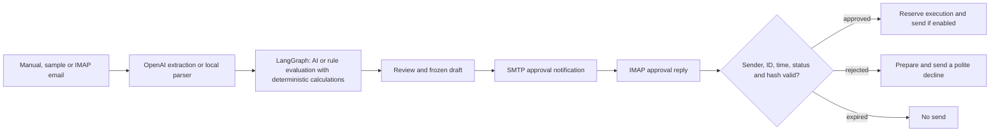

# Real Estate AI Deal Analyzer

FastAPI and React application for preliminary wholesale property analysis and email-based human approval. Financial calculations are deterministic; classification can use Python rules or an AI assessment. Email approval and sending are controlled by `HITL_EMAIL_ENABLED`; optional automatic ingestion has a separate setting. Both are disabled by default.

## Run

```powershell
python -m venv .venv
.\.venv\Scripts\Activate.ps1
pip install -r requirements.txt
Copy-Item .env.dev .env
npm install --prefix frontend
npm run build --prefix frontend
python -m uvicorn backend.main:app --host 127.0.0.1 --port 8000
```

Open http://127.0.0.1:8000. Set `AI_ENABLED=true`, `OPENAI_API_KEY`, and `OPENAI_MODEL` in `.env` to enable OpenAI extraction, LangChain AI evaluation, drafting and comment polishing. `AI_ENABLED=false` uses the limited local parser, deterministic rule classification and template replies even if a key exists. Restart the backend after changes. AI mode requires a key and reports an error when it is missing. Run `python -m pytest -q` for mocked tests. Sample emails are fictional.

## Email setup

Set `HITL_EMAIL_ENABLED=true` and configure SMTP, IMAP, `APPROVER_EMAILS`, and `APPROVAL_REPLY_TO` to send approval requests, monitor replies, and send the frozen response after valid approval. The reply-to address must deliver into `IMAP_FOLDER`. With `HITL_EMAIL_ENABLED=false`, deals and drafts are displayed for review without approval requests or outbound sending. Changing the switch requires a backend restart. Historical approvals and recorded executions remain visible. SMTP uses STARTTLS; IMAP uses TLS. Restart after changing `.env`. Never share credentials or commit `.env`.

`APPROVAL_TIMEOUT_MINUTES` sets the approval deadline (default 20); `APPROVAL_POLL_INTERVAL_SECONDS` sets the polling interval. `BUYER_NAME` and `BUYER_COMPANY` are used in the generated response. `DATABASE_URL` selects the SQLite file.

To ingest incoming offers automatically, set `LIVE_EMAIL_INGESTION_ENABLED=true` and configure IMAP. `INGESTION_IMAP_FOLDER` chooses the source folder (default `INBOX`); it can be different from the approval folder. The independent `LIVE_EMAIL_INGESTION_ENABLED` option controls only automatic offer ingestion; it is not needed for manual input or email approvals. The worker scans messages, deduplicates by mailbox UID, and applies a simple property-and-price keyword filter before processing. This filter may miss offers or include unrelated messages; review all results. Automatic ingestion never approves or sends replies.

Successful SMTP acceptance does not guarantee delivery. A send failure or timeout is recorded as `NEEDS_RECONCILIATION` and is not automatically retried. A process interruption can leave `SENDING`, which also requires reconciliation. IMAP uses server INTERNALDATE and scans before expiring requests; scan errors defer expiration. Run one application process and use a trustworthy mailbox clock.

**Security:** The local API has no login. Bind to localhost and do not expose it to an untrusted network. Sender addresses can be forged; the 128-bit approval ID acts as a confidential capability, but is not cryptographic proof of sender identity. Protect the mailbox, dashboard, database and logs. The real provider integrations have only been tested with mocks, not independently security-reviewed.

## Architecture and limitations



MAO (Maximum Allowable Offer) = ARV (After Repair Value) × configured ratio − repairs; gross spread = ARV (After Repair Value) − asking price − repairs. Net profit and ROI (Return on Investment) remain unknown until required costs are supplied. Estimates are preliminary and based on unverified wholesaler data.

LangGraph orchestrates extraction and evaluation. When enabled, LangChain uses the OpenAI Responses API with structured output for an AI assessment; the AI assesses and classifies the property without running the Python classification rules. Calculated numbers remain authoritative Python results, and the AI assessment remains preliminary. The Responses drafting integration exposes one function to the model. A validated internal registry contains nine named tools, but not all are exposed to the model. SQLAlchemy mapped classes cover existing email, deal, approval, execution and mailbox tables; transactional code still uses sqlite3 and evaluation/draft are JSON snapshots. Full normalized models, the full requested tool-calling flow, and the complete audit timeline are not finished. OpenAI and email integrations have not been tested against actual services.

The deal detail view shows recorded activity and current status. `SMTP_ACCEPTED` means the SMTP server accepted the message, not that the recipient received it. Historical events can only show what the application actually recorded.

Set `SECOND_DRAFT_APPROVAL_ENABLED=true` to require a second email approval whenever a first decision leads to a revised response: an approval with a comment, or a rejection that generates a polite decline. The approver receives the exact revised draft. A second APPROVED sends that exact draft; a second REJECTED cancels it. A comment on the second decision is rejected; reject and revise instead. With the setting false, the revised response is sent after the first valid decision. An approved first draft without a comment is unchanged and sent after the first approval in either mode.

Approval replies must include `Approval ID: RE-...` and `Decision: APPROVED` or `Decision: REJECTED`; labeled fields can be on the same line or separate lines. An optional single line `Comments: ...` is stored and displayed with the approver address. The approval ID links the reply to one frozen draft and is a confidential capability. An approved draft without a comment is sent unchanged. A rejection or an approval with a comment produces a follow-up message using OpenAI when AI is enabled, with a template fallback on error; the second approval setting determines whether another approval is required before sending. The final text may differ from the draft reviewed by the approver; the exact attempted message is stored in the execution record. SMTP acceptance means only that the mail server accepted the message, not that it was delivered.

AI prompts treat emails and approver comments as untrusted content, prohibit invented details and binding commitments, and identify estimates as preliminary. Conservative checks reject unsupported numbers, new URLs or email addresses, and certain commitment phrases. AI classifications with missing or contradictory essential financial inputs are rejected. If a generated follow-up fails these checks, the application falls back to the original template; if that is also unsafe, it records `REQUIRES_REVIEW` and does not send. These checks are heuristics and do not guarantee that all AI output is factual. When second approval is off, the AI-polished response may be sent without a human reviewing the final wording.

Approval notifications present the saved deal analysis, classification, financial inputs and calculations, criteria, risks, missing details, assumptions, and the complete proposed wholesaler response. The explanation is AI-generated only when the deal was analyzed with AI enabled; older deals retain their recorded source. To create a fresh analysis from an existing saved email, open the deal and select **Reanalyze with current settings**. A pending approval for that email must first be resolved or explicitly canceled in the dashboard; cancellation makes later replies to that request ineligible to send. The earlier deal and approval history are retained.

Buyer approval emails contain a bold disclaimer in HTML (plain text uses a clearly labeled disclaimer), property and financial details, the saved AI or rule-based recommendation, the complete proposed wholesaler reply, approval ID, deadline and decision instructions. The disclaimer and buyer summary are assembled from saved data; the proposed response is AI-generated when AI was enabled for that analysis. Drafts and approval state are persisted before sending so the approved payload can be verified and recovered after restart; the execution result and actual attempted message are recorded afterward.

The blue **Agent message** card previews the buyer approval message from the saved draft. Before an approval request, the ID and deadline are placeholders; the actual values appear once the request is created. Save draft edits to update the preview.

For new AI evaluations, the buyer recommendation includes an overall explanation, a financial interpretation, fit with buying criteria, and due-diligence questions. AI-written figures are checked against supplied inputs and calculated metrics. Existing evaluations retain their originally saved explanation; use the dashboard reanalysis action to create an updated evaluation.

Approval emails include Approve and Reject links. Each opens a prefilled email reply in the approver’s mail app, where they can add a comment and press Send. Clicking a link alone does not submit a decision; the incoming reply still passes the existing sender, ID, deadline and status checks. Email-client behavior varies, so the plain-text reply instructions remain available.

The buyer decision brief uses a senior acquisitions-advisor prompt. The application calculates every configured buying criterion as met, not met, unknown, or informational, and supplies those results to the AI; the AI provides the verdict and explanation without overriding a failed mandatory requirement. The buyer approval message shows the complete checklist, concise reasoning, recommended next action, and up to three risks and three due-diligence questions. If required facts are missing, the AI is instructed to request them instead of inventing figures. Existing evaluations retain their original snapshots; reanalyze to use the updated prompt.

The deal activity timeline shows the approver and comment, reply preparation, the wholesaler address, the start of sending, and the resulting mail-server status. The dashboard refreshes the selected deal about every 10 seconds while it is visible and keeps unsaved draft edits. Mail-server acceptance is not proof of delivery.
