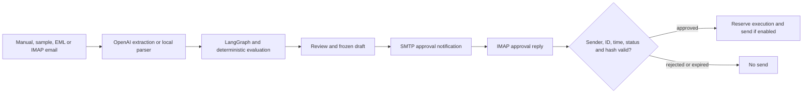

# Real Estate AI Deal Analyzer

FastAPI and React application for preliminary wholesale property analysis and email-based human approval. Financial calculations and classification are deterministic. Email approval and sending are controlled by `HITL_EMAIL_ENABLED`; optional automatic ingestion has a separate setting. Both are disabled by default.

## Run

```powershell
python -m venv .venv
.\.venv\Scripts\Activate.ps1
pip install -r requirements.txt
Copy-Item .env.dev .env
npm install --prefix frontend
npm run build --prefix frontend
python -m uvicorn backend.main:app --host 127.0.0.1 --port 8000
```

Open http://127.0.0.1:8000. Set `OPENAI_API_KEY` and `OPENAI_MODEL` in `.env` for Responses API extraction and drafting. Without a key, a limited local parser and template replies are used. Run `python -m pytest -q` for mocked tests. Sample emails are fictional.

## Email setup

Set `HITL_EMAIL_ENABLED=true` and configure SMTP, IMAP, `APPROVER_EMAILS`, and `APPROVAL_REPLY_TO` to send approval requests, monitor replies, and send the frozen response after valid approval. The reply-to address must deliver into `IMAP_FOLDER`. With `HITL_EMAIL_ENABLED=false`, deals and drafts are displayed for review without approval requests or outbound sending. Changing the switch requires a backend restart. Historical approvals and recorded executions remain visible. SMTP uses STARTTLS; IMAP uses TLS. Restart after changing `.env`. Never share credentials or commit `.env`.

`APPROVAL_TIMEOUT_MINUTES` sets the approval deadline (default 20); `APPROVAL_POLL_INTERVAL_SECONDS` sets the polling interval. `BUYER_NAME` and `BUYER_COMPANY` are used in the generated response. `DATABASE_URL` selects the SQLite file.

To ingest incoming offers automatically, set `LIVE_EMAIL_INGESTION_ENABLED=true` and configure IMAP. `INGESTION_IMAP_FOLDER` chooses the source folder (default `INBOX`); it can be different from the approval folder. The independent `LIVE_EMAIL_INGESTION_ENABLED` option controls only automatic offer ingestion; it is not needed for manual input or email approvals. The worker scans messages, deduplicates by mailbox UID, and applies a simple property-and-price keyword filter before processing. This filter may miss offers or include unrelated messages; review all results. Automatic ingestion never approves or sends replies.

Successful SMTP acceptance does not guarantee delivery. A send failure or timeout is recorded as `NEEDS_RECONCILIATION` and is not automatically retried. A process interruption can leave `SENDING`, which also requires reconciliation. IMAP uses server INTERNALDATE and scans before expiring requests; scan errors defer expiration. Run one application process and use a trustworthy mailbox clock.

**Security:** The local API has no login. Bind to localhost and do not expose it to an untrusted network. Sender addresses can be forged; the 128-bit approval ID acts as a confidential capability, but is not cryptographic proof of sender identity. Protect the mailbox, dashboard, database and logs. The real provider integrations have only been tested with mocks, not independently security-reviewed.

## Architecture and limitations



MAO = ARV × configured ratio − repairs; gross spread = ARV − asking price − repairs. Net profit and ROI remain unknown until required costs are supplied. Estimates are preliminary and based on unverified wholesaler data.

The Responses drafting integration exposes one function to the model. A validated internal registry contains nine named tools, but not all are exposed to the model. SQLAlchemy mapped classes cover existing email, deal, approval, execution and mailbox tables; transactional code still uses sqlite3 and evaluation/draft are JSON snapshots. Full normalized models, the full requested tool-calling flow, and the complete audit timeline are not finished. OpenAI and email integrations have not been tested against actual services.

The deal detail view shows recorded activity and current status. `SMTP_ACCEPTED` means the SMTP server accepted the message, not that the recipient received it. Historical events can only show what the application actually recorded.
